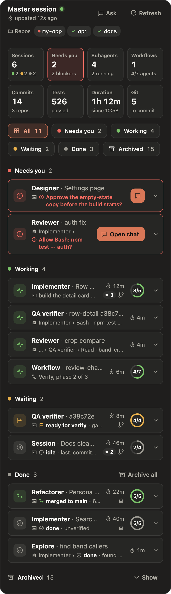
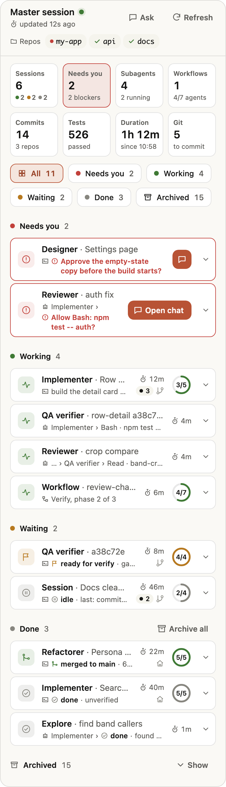
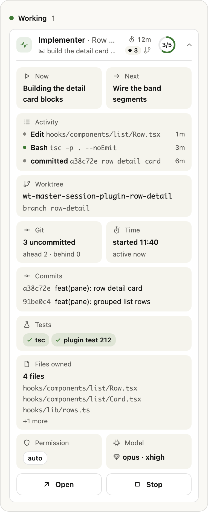
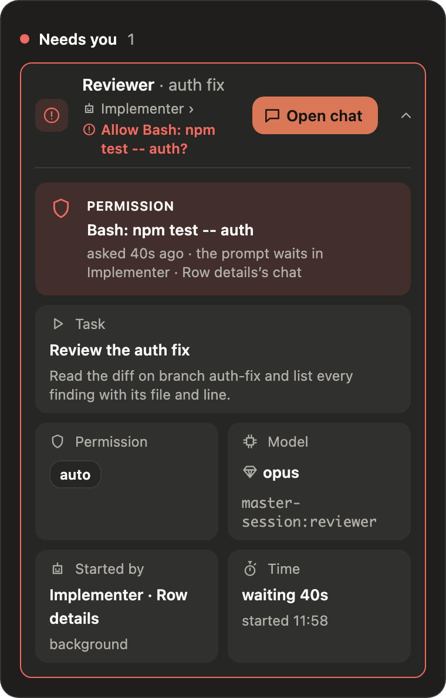
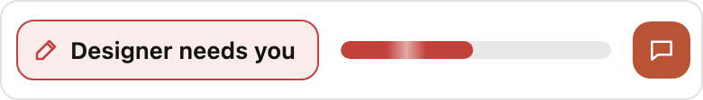
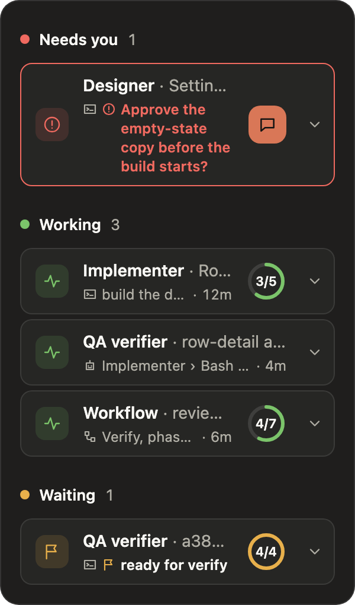

# Master session

A Claude Code plugin that turns one session into a **validator** for a team of worker sessions. The validator plans the work, briefs a worker session per piece, watches them, answers their questions, verifies every `ready <sha>` in a clean worktree and merges it fast-forward only. You get a live status board instead of a scrolling chat.

<p align="center"></p>

## What's inside

| Part | What it does |
|---|---|
| Skill `start` | `/master-session:start`, the validator protocol: roles, briefs, the tick loop, verification, permissions, the ledger. Ships `personas.md` (the persona index) and `board.md` (the chat board when the pane isn't available). |
| Skills `subchat`, `subagent`, `workflow` | `/master-session:subchat`, `/master-session:subagent` and `/master-session:workflow`: start a worker session, a persona subagent or a workflow of persona agents from the validator. |
| Skill `worker` | The protocol every worker session follows: its own worktree, the report tool, talking to the validator, the `ready <sha>` gate. |
| Status mod | `/master-session:info` opens it: a pane beside the chat with one row per worker (state, progress, git, tests, commits) under run-total tiles, a band above the prompt, archive and unarchive, and **Ask for updates** (shown once workers are listed). Workers report through the `mcp__master-session__report` tool; the mod also records their commits, test runs, edits and waits by itself. |
| Personas | Nine roles, each a skill plus an agent of the same name: `implementer`, `refactorer`, `reviewer`, `qa-verifier`, `design-checker`, `researcher`, `spec-writer`, `architect` and `designer`. |

## Install

At the prompt of a Claude Code terminal session:

```
/plugin install master-session --marketplace OlehPetrykUA/master-session-plugin
```

Answer `y` to add the marketplace, then pick a scope (user scope is the first choice).

From a shell:

```bash
claude plugin install master-session --marketplace OlehPetrykUA/master-session-plugin
```

Or in two steps, adding the marketplace once:

```bash
claude plugin marketplace add OlehPetrykUA/master-session-plugin
```

```bash
claude plugin install master-session@master-session
```

In the Claude desktop app, where `/plugin` does not run: click **+** next to the prompt box, then **Plugins**, **Add marketplace** with `OlehPetrykUA/master-session-plugin`, then **Add plugin**. A plugin installed at user scope from a terminal also loads in the desktop app's local sessions.

Update later with `claude plugin update master-session@master-session`.

## Copilot CLI

GitHub Copilot CLI loads the same plugin from a clone, live: nothing is copied, and each change in the folder shows up in the next session.

```bash
copilot plugin marketplace add <path to your clone>
```

```bash
copilot plugin install master-session@master-session
```

`copilot plugin list` shows it under "Live Plugins". The skills keep their own names (`start`, `subchat`, `worker`, the personas), and the agents are `master-session:<persona>`. `start`, `info`, `subchat`, `subagent` and `workflow` are for the user to type, so `copilot -p` doesn't run them.

Copilot has no session tools, report tool, status mod or loop. Each skill's "In Copilot CLI" section says what to do instead: the user opens worker sessions and relays their reports, personas run through the `task` tool with a Copilot model id (Copilot rejects the agents' `sonnet` and `opus`), and the board goes in chat. The agents carry `reasoning-effort` for Copilot beside `effort` for Claude Code.

Copilot over ACP, as in JetBrains IDEs, loads no plugins from a local-folder marketplace; the interactive `copilot` and `copilot -p` do.

## Usage

| Command | What it does |
|---|---|
| `/master-session:start [task] [settings]` | Turns the current session into the validator. |
| `/master-session:subchat <task> [persona]` | Starts a worker session, a side chat, for the task (persona `implementer` by default) and watches it in the loop. |
| `/master-session:subagent <persona> <task>` | Runs a persona as a background subagent for a short check, then relays its result. |
| `/master-session:workflow <task>` | Writes and runs a workflow for the task with persona agents, announcing the agent count first. |
| `/master-session:info [ask]` | Opens the status pane; `ask` asks every running worker for a fresh report. |

`subchat`, `subagent` and `workflow` make the session the validator first if `/master-session:start` hasn't run yet. Settings for `/master-session:start`, in any order:
- `new "<task>"` starts a fresh worker for that task; `worker <name>` attaches an existing session.
- `every 5m` sets the heartbeat (default 2 minutes); `away` finishes everything inside the briefs without waiting; `quiet` or `verbose`.
- `tick now`, `status`, `stop`, `archive-done`.

Workers need nothing installed beyond this plugin: their brief loads the `master-session:worker` skill and their persona's skill, and they report through the status tool.

The ledger, one note per run with every worker, its state and open findings, goes in your notes or memory tool, or a plain markdown file if you use none.

## Screenshots

| Light | Dark |
|---|---|
|  |  |
| The status pane: run totals, filter chips and every worker grouped by state. | The same pane in the dark theme. |
|  |  |
| A session opened in place: now and next, activity, worktree, git, commits, tests and files. | A subagent waiting on a permission prompt, with Open chat for the chat that holds it. |
|  |  |
| The band above the prompt names whoever needs you, shows one progress bar and opens their chat. | The pane at 300 px: the meta column folds into the second line. |

## Personas

Each persona is a skill, `master-session:<persona>`, and an agent of the same name that keeps the model, effort and tool limits listed in [personas.md](skills/start/personas.md). The code reviewer, QA verifier, design checker and researcher can't edit files.

| Persona | What it does |
|---|---|
| `implementer` | Builds one deliverable from a brief in its own worktree and reports `ready <sha>`. |
| `refactorer` | Moves, renames or splits code without changing behaviour. |
| `reviewer` | The Code reviewer, a peer of the QA verifier: reads a `ready <sha>` against its brief, the spec, the user's words and code quality, ending in PASS or FAIL. |
| `qa-verifier` | Owns the verification of a ready sha: gate, tests, mutations and live checks in a clean detached worktree, (UI) Design checker as its own subagent, live screenshot when given a window id; returns one PASS or FAIL with bundled findings. |
| `design-checker` | Compares the built UI with the approved design. |
| `researcher` | Answers one question from published docs, citing each claim. |
| `spec-writer` | Writes the feature's spec in the project's Claude Doc, one tab per feature, with testable acceptance criteria, before design and build. |
| `architect` | For features spanning several modules or workers: turns the approved spec into a technical design in its tab (module map, interfaces, one piece per worker, order, risks, test proofs); read-only on code. |
| `designer` | Draws the UI design as new artboards in the project's design canvas, in light and dark, for the user to approve before any UI code. |

Start a session as a persona. Claude Code's default system prompt is kept, and the plugin's SessionStart hook loads the persona's skill, plus the worker skill for the implementer and refactorer:

```bash
claude --agent master-session:implementer
```

The validator also spawns each one as a subagent, `master-session:<persona>`, which preloads its persona skill. The persona and worker skills stay out of the `/` menu. The desktop app's `start_session` can't pick an agent, so a worker started there loads the skills from its brief instead.

## Requirements

- Claude Code 2.1.275 or later for the one-line `/plugin install … --marketplace` form, 2.1.292 or later for its shell form. Built and tested on 2.1.304.
- The Claude desktop app's **Code** tab. The skill starts and messages worker sessions through the app's session tools, and the pane draws there. In a terminal the mod falls back to a text pane and band.
- git. Workers work in their own worktrees and the validator merges with `--ff-only`.

The mod keeps worker reports under `~/.claude/state/master-session/`.

## Development

```bash
claude plugin validate .
```

```bash
claude plugin test .
```

`plugin test` runs the mod's tests only. Check the SessionStart persona hook with:

```bash
sh hooks/persona.test.sh
```

Type-check against the engine's generated types: load the plugin once with `claude --plugin-dir .` so the engine writes `.claude-plugin/types/`, then run `tsc -p .`.

## License

[MIT](LICENSE)
